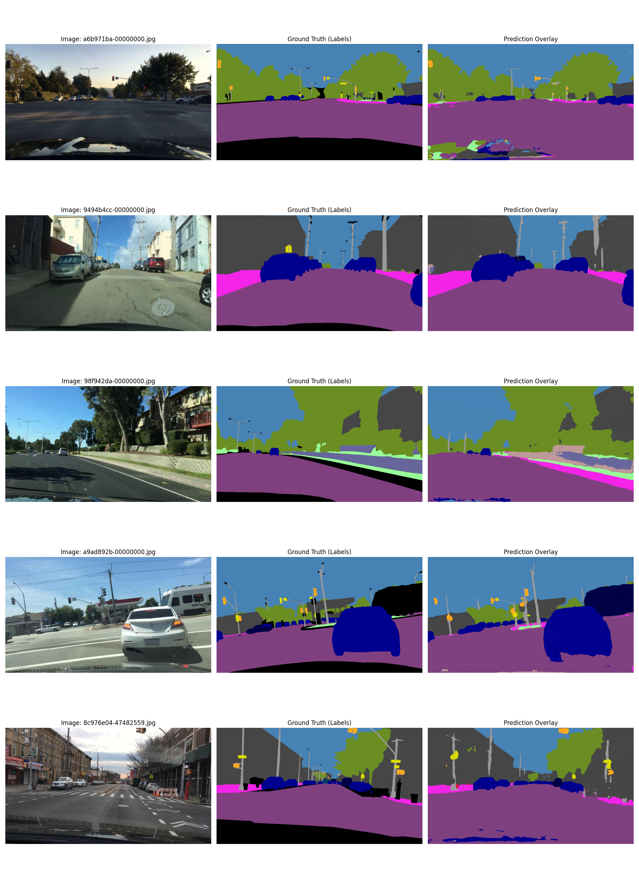
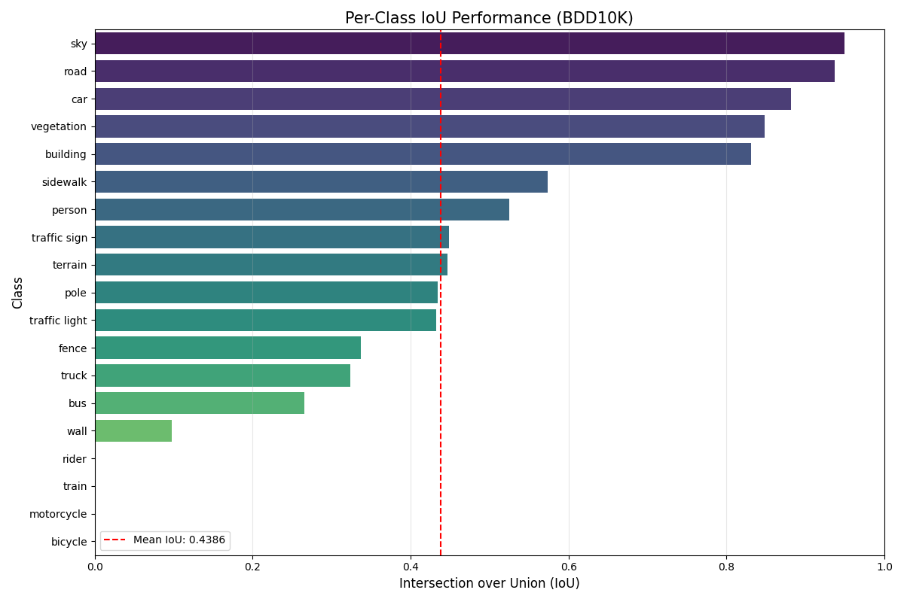
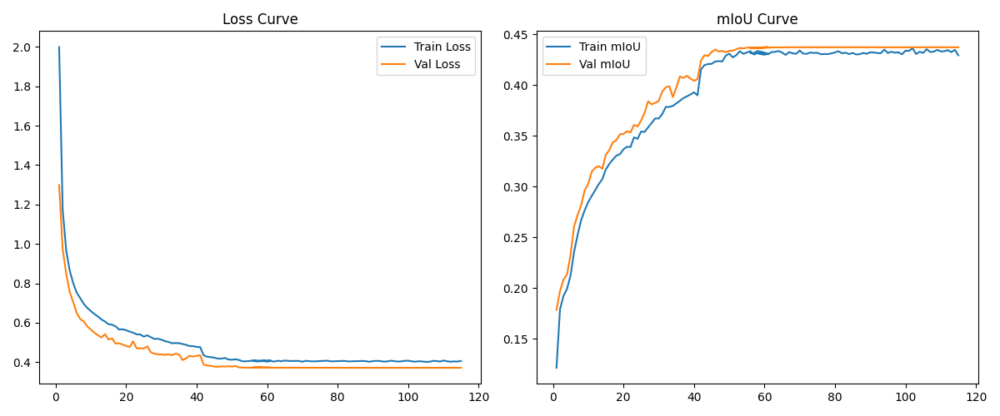

# 🚗 Semantic Segmentation for Autonomous Driving

**Pixel-level scene understanding on real-world dashcam footage from the BDD100K dataset**

A U-Net with a ResNet-50 encoder, trained end to end to label every pixel of a driving scene
as one of **19 classes**: road, sidewalk, car, pedestrian, traffic light, sky, and more.

---

## 🖼️ Results

<p align="center">
  
</p>

<p align="center"><em>Left: raw dashcam frame · Middle: human-annotated ground truth · Right: model prediction.<br>All images are from the held-out validation set, so the model never saw them during training.</em></p>

### Validation metrics (1,000 held-out images)

<div align="center">

| Metric | Score |
|:--|:--:|
| **Pixel Accuracy** | **79.0%** |
| **Mean IoU** (19 classes) | **43.9%** |
| Road IoU | 93.7% |
| Sky IoU | 95.0% |
| Car IoU | 88.2% |
| Vegetation IoU | 84.9% |
| Building IoU | 83.2% |

</div>

<p align="center">
  
</p>

---

## Project Overview

Self-driving systems need to know what is in front of them and also exactly where it is, down to
the pixel. This project builds a complete semantic segmentation pipeline (data ingestion, augmentation,
training, evaluation, and visualization) on the
[Berkeley DeepDrive (BDD100K)](https://www.vis.xyz/bdd100k/) 10K segmentation subset. BDD100K is one of the
largest and most diverse driving datasets. It covers different cities, weather, and times of day.

| | |
|:--|:--|
| **Task** | Multi-class semantic segmentation (19 Cityscapes-style classes) |
| **Data** | 7,000 training / 1,000 validation images at 1280×720 |
| **Model** | U-Net + ResNet-50 encoder (ImageNet-pretrained), BatchNorm → GroupNorm |
| **Input resolution** | 512 × 1024 |
| **Training** | ~115 epochs on a Kaggle GPU, with checkpoint/resume across sessions |

---

## 🧠 Technical Highlights

### Architecture
- **U-Net with a pretrained ResNet-50 backbone** (via `segmentation_models_pytorch`). It combines ImageNet features with skip connections to keep fine spatial details.
- **BatchNorm → GroupNorm conversion.** At 512×1024 resolution only **4 images fit in GPU memory**, and BatchNorm statistics are unreliable at that batch size. [`src/models/model.py`](src/models/model.py)) swaps every `BatchNorm2d` for `GroupNorm`, which normalizes independently of batch size.

### Training under GPU memory limits
- **Gradient accumulation** gives an *effective* batch size of 32 from micro-batches of 4.
- **Gradient clipping** (max-norm 1.0) keeps updates stable.
- **Adam + `ReduceLROnPlateau`** drops the learning rate 10× when validation loss plateaus. The jumps in the learning curves below line up with these drops.
- **Early stopping** with configurable patience.

### Handling class imbalance
Driving scenes are dominated by road, sky, and buildings, while riders and bicycles are tiny and rare.
The model uses a **class-weighted Cross-Entropy loss** ([`src/engine/criterion.py`](src/engine/criterion.py)) that up-weights
rare, safety-critical classes such as traffic lights, pedestrians, and riders. Unlabeled "void" pixels are
excluded with `ignore_index=255`.

### Robustness-focused data augmentation
An [Albumentations](https://albumentations.ai/) pipeline ([`src/data/transforms.py`](src/data/transforms.py)) simulates real driving conditions:

| Category | Augmentations |
|:--|:--|
| **Spatial** | Random resized crop, horizontal flip, affine (rotate / translate / scale) |
| **Lighting & weather** | Brightness/contrast, color jitter, random shadows, CLAHE |
| **Sensor noise** | Gaussian noise, Gaussian blur |

Image and mask are transformed together. Padding introduced by geometric transforms is filled with the
ignore index so the loss doesn't learn from it.

### Engineering & reproducibility
- **One YAML config** ([`config.yaml`](config.yaml)) holds all hyperparameters, paths, and augmentation settings.
- **Automatic environment detection** switches data and checkpoint paths between **local** and **Kaggle** runs.
- **Resumable training.** Model, optimizer, and scheduler state and training history are checkpointed, so long runs can continue across Kaggle's session limits.
- **Every run is self-documenting.** Each run saves its config snapshot, a CSV training log, and auto-generated learning curves to a timestamped folder.
- **Evaluation script** ([`eval.py`](eval.py)) outputs per-class IoU, pixel accuracy, a confusion matrix, and (optionally) the predicted masks.
- **Device-agnostic.** Runs on CUDA, Apple Silicon (MPS), or CPU.

---

## 📈 Training Curves

<p align="center">
  
</p>

Validation tracks training closely throughout, so the model isn't overfitting. The sharp improvement
near epoch 42 comes from the learning-rate scheduler stepping the LR down from 1e-4 to 1e-5.

---

## 🗂️ Project Structure

```
bdd10k-segmentation/
├── config.yaml              # All hyperparameters, paths & augmentation settings
├── train.py                 # Training loop: grad accumulation, checkpointing, early stopping
├── eval.py                  # Per-class IoU, pixel accuracy, confusion matrix
├── src/
│   ├── data/
│   │   ├── dataset.py       # PyTorch Dataset for BDD100K images + label masks
│   │   ├── transforms.py    # Albumentations train/val pipelines
│   │   └── unpack.py        # Extracts raw dataset zips
│   ├── models/model.py      # U-Net/ResNet-50 + BatchNorm→GroupNorm conversion
│   ├── engine/
│   │   ├── criterion.py     # Class-weighted CE loss & optimizer
│   │   └── device.py        # CUDA / MPS / CPU selection
│   └── utils/               # Config loader, color palette, mask colorization
├── notebooks/               # Evaluation & visualization notebooks
└── assets/                  # Figures used in this README
```

---

## 🚀 Getting Started

```bash
# 1. Install dependencies
pip install -r requirements.txt

# 2. Download the BDD100K 10K images + segmentation maps into data/raw/, then extract
python -m src.data.unpack

# 3. Train (settings in config.yaml; resumes from the latest checkpoint automatically)
python train.py

# 4. Evaluate on the validation set
python eval.py \
  --img_dir data/processed/images/val \
  --mask_dir data/processed/labels/val \
  --output_dir eval \
  --save_preds
```

---

## 🔍 Analysis & Next Steps

**What works well:** the model is strong on large, structured classes that matter most for drivable-area
reasoning: **road (94%)**, **sky (95%)**, **car (88%)**, **vegetation (85%)**, and **building (83%)**.
The predictions above show clean boundaries on vehicles and roads, and it also picks up thin structures
such as poles and traffic lights.

**Where it struggles:** very rare classes (*rider, train, motorcycle, bicycle*) make up a tiny fraction
of pixels in the 7K training images, and the model does not yet segment them. Class weighting alone
isn't enough for these.

**Planned improvements:**
- [ ] Dice / Focal loss, or combined CE + Dice, to further address class imbalance
- [ ] Oversample images that contain rare classes
- [ ] Try stronger backbones (e.g. ConvNeXt, MiT/SegFormer) and DeepLabV3+
- [ ] Full-resolution video inference ([`inference.py`](inference.py))
- [ ] Mixed-precision (AMP) training for larger batch sizes